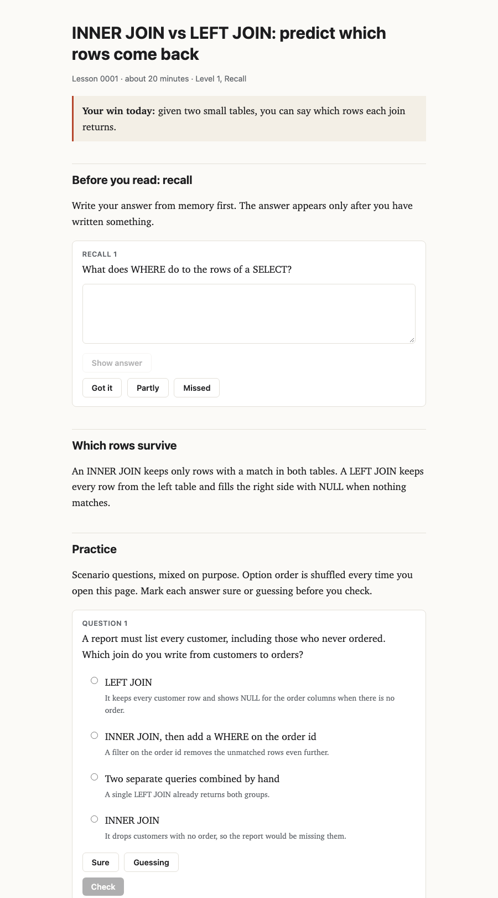

# Learning Coach

A skill that coaches a learner through studying anything, using methods from learning research: testing yourself and spaced review (high utility), plus explaining ideas back, mixing topics and checking your own understanding (moderate, or practice judgment). It works with Claude Code and other tools that read `SKILL.md` skills.

## What it does

The agent runs a repeating cycle:

1. **Place:** a 25-minute test (first step 4 minutes) finds the starting level (1 to 6).
2. **Set the bar:** it states what you must show to pass the level, before you study.
3. **Study:** sessions of practice, reading, and self-testing (60 minutes by default), logged in a progress file the agent reads each time. New material can come as a short HTML lesson page: recall first, a plain explanation, then practice questions, each marked sure or guessing before it is checked.
4. **Check:** a check in the format for your level (a 10-question self-test, a teach-back that may be written or spoken, or a finished task scored against a private checklist), passed at 80%.
5. **Rebuild:** you rewrite a one-page summary from memory.
6. **Advance:** pass, move up, and keep reviewing earlier levels.

It covers eight techniques: foundations (sleep, focus), retrieval practice, spaced repetition, elaboration, interleaving, metacognition, teach-back, and decision quality.

## Lesson pages

New material can come as a self-contained HTML page you open in the browser: recall first, a short explanation with sources, then practice questions. No server, no account.



The sample page is in [`docs/sample/`](docs/sample/lessons/0001-inner-vs-left-join.html).

Features:

- **Recall before reading:** write an answer from memory, then reveal the model answer and mark it got it, partly, or missed.
- **Exam-style questions:** six options by default; multi-select questions say how many to pick. Options state only the choice, never a reason. Order is shuffled once per learner and page, and the order is saved.
- **Sure or guessing:** mark each answer before checking, so the score also shows overconfidence (wrong but sure) and luck (right but guessing).
- **Reason first on drills:** drills also ask for a one-line reason before the answer is checked.
- **Explanations after answering:** every option explains why it is right or wrong once you have checked.
- **Difficulty that adapts:** drills aim at 70 to 85 percent right and step up above 85 percent on the last page (see `levels.md`).
- **Result line:** one line to paste back, which goes into the learning log and queues missed questions for review.
- **Bilingual option:** English by default, with a second language switch.
- **Checker:** `assets/check-lesson.js` flags answer cues in option length and in reasons written into options.

## Who it's for

Anyone studying a subject or building a skill who wants a coach that tests them instead of just explaining. It is not for quick factual questions; the agent answers those directly.

## Requirements

Node for the lesson checker, Python 3 for the validator.

## Install

Claude Code, as a plugin:

```
/plugin marketplace add heart-reburn/learning-coach
/plugin install learning-coach@learning-coach
```

Or copy the skill folder by hand:

```
cp -R skills/learning-coach ~/.claude/skills/
```

Other tools that read `SKILL.md` folders: copy `skills/learning-coach/` into that tool's skills directory.

## Example

> **You:** I have a biology exam in three weeks. Help me study cell division.
>
> **Coach:** First, we set up foundations: a weekly schedule and sleep. Then a placement test. Close your notes and write everything you know about cell division for ten minutes.
>
> *(You write 6 facts.)*
>
> **Coach:** Good start. Now explain mitosis aloud as if to a 12-year-old.
>
> *(You stumble at how chromosomes separate.)*
>
> **Coach:** You start at Level 2: Explain. To pass, you need to explain why each phase happens, in your own words. This week: 4 sessions of 60 minutes. Session 1 comes as a lesson page: recall first, a short explanation, then practice questions. Open it, and tell me your predicted score first.

## Evidence

The methods come from learning research: practice testing and spaced practice rated high-utility, self-explanation, elaborative interrogation and interleaving moderate, and rereading, highlighting, and summarizing rated low (Dunlosky et al., 2013). Full sources are in [`skills/learning-coach/references/techniques.md`](skills/learning-coach/references/techniques.md).

The pass and drop thresholds are starting points, not research results, and the file says so.

## Repo layout

- `skills/learning-coach/SKILL.md`: the skill.
- `skills/learning-coach/references/`: placement test, levels, techniques, progress-file format, lesson pages.
- `skills/learning-coach/assets/`: lesson and reference-sheet templates, stylesheet, quiz component, optional language switch.
- `skills/learning-coach/evals/`: trigger tests (should and should not load) and behavior tests (what the skill does once loaded).
- `docs/`: sample lesson page and its screenshot.
- `scripts/judge_compare.py`: runs the behavior evals with two independent judges.
- `scripts/validate.py`: checks frontmatter and file links (runs in CI). `scripts/run_evals.py` runs the evals with any agent CLI (set `SKILL_EVAL_CMD`; defaults to the Claude CLI).

## License

MIT. See [LICENSE](LICENSE).
